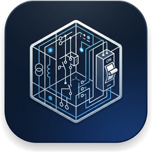
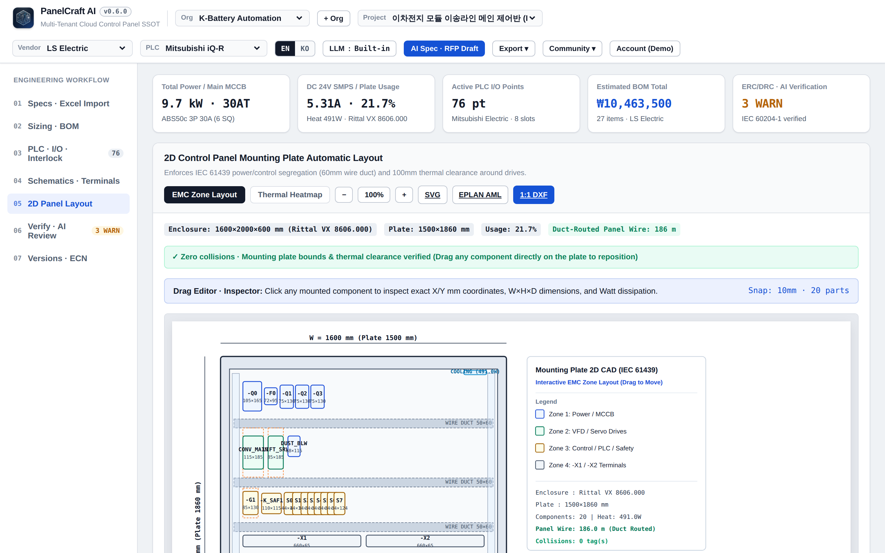

<p align="center">
  
</p>

<h1 align="center">PanelCraft AI</h1>

<p align="center">
  <strong>B2B Cloud SaaS Control Panel SSOT Design Automation Platform (v0.7.0)</strong><br />
  IEC 60909 Short-Circuit &amp; Selectivity · IEC 60890 Thermal/Cooling · EPLAN .ema Macro Editor · Multi-Tenant RBAC · Interactive 2D Drag-and-Drop
</p>

---

## Key Capabilities

- **IEC 60909 Short-Circuit, Breaker Selectivity & IEC 60890 Precision Thermal (`v0.7.0`)**: Prospective 3-phase fault current ($I''_{k3}$), peak $i_p$, main/branch $I_{cu}$ breaking check (`ERC-005`), upstream/downstream selectivity matrix (`TOTAL`/`PARTIAL`/`NON-SEL`, `ERC-006`), and IEC 60890 effective enclosure dissipation ($A_e$, $P_{\text{nat}}$, uncooled vs cooled temperature, automatic Rittal TopTherm Fan / Blue e+ Panel AC BOM sizing).
- **Company EPLAN Electric P8 `.ema` Macro Library Editor & XML Exporter (`v0.7.0`)**: Manage tenant-scoped `.ema` macro paths, Variants (`A–P`), and Placeholder Object variables; auto-applied across EPLAN AML, schematics, standalone `.ema` XML export (`<EplanPxfRoot>` / `<O117>` / `<ValueSet>`), and Full Engineering ZIP (`EPLAN/macros/*.ema`).
- **Multi-Tenant B2B Cloud SaaS, JWT Auth & 4-Role RBAC (`v0.6.0`)**: Organization workspaces (`Org`), PBKDF2-SHA256 + HS256 JWT authentication, 4-role RBAC (`admin`, `reviewer`, `designer`, `viewer`) enforced on mutations and `Released` revision approvals, audit trail, and unified **SQLite / PostgreSQL (`DATABASE_URL`)** database adapter with Docker Compose.
- **Interactive 2D Mounting Plate Drag-and-Drop, Collision & Wire BOM (`v0.6.0`)**: 10mm grid-snapped SVG Drag-and-Drop placement with persisted coordinates, real-time collision (`LAY-001`), plate boundary (`LAY-002`), and drive thermal clearance (`LAY-003`) alerts synced to Rule Checks, Thermal Heatmap overlay, 1:1 mm DXF, and **Manhattan duct-routed Panel Internal Wire length estimation** automatically injected into the Unified BOM (`M`).
- **Deterministic Electrical Sizing, 7 Electrical Vendors, 6 PLC Vendors & Multi-Sheet Schematics**: UL 508A / IEC 60204-1 / KS C IEC 60364, step-down transformer sizing, PLCopen TC6 XML, auto-paginated schematics & multi-sheet DXF, Excel/CSV & PDF RFP LLM Gateway, and GitHub Auto-Update + Issues/Discussions.

---

## Screenshots

| Specs & Excel/Catalog Import (EN) | Interactive 2D Drag-and-Drop Layout & Wire BOM |
| :---: | :---: |
|  |  |

| IEC 61082 Multi-Sheet Schematics | Multi-Tenant Auth & 4-Role RBAC Modal |
| :---: | :---: |
|  |  |

---

## Cross-Platform & Cloud SaaS Deployment

### 1. Local Web Server or Cloud Docker Compose (PostgreSQL 16 + FastAPI)
```bash
# Local (SQLite)
pip install -r requirements.txt
uvicorn backend.main:app --host 0.0.0.0 --port 8000

# Cloud SaaS (PostgreSQL 16 + FastAPI)
docker compose up -d
```

### 2. Desktop Installers — Windows (`.exe`/`.msi`), macOS (`.dmg`), Linux (`.AppImage`/`.deb`)
```bash
# Bundle embedded Python backend binary
pip install pyinstaller
pyinstaller --clean --distpath dist/backend packaging/panelcraft-backend.spec

# Build platform installer with Electron + Auto-Updater
cd desktop
npm install
npm run dist:win    # Windows NSIS (.exe) & MSI
npm run dist:mac    # macOS (.dmg arm64 + x64)
npm run dist:linux  # Linux (.AppImage + .deb)
```

### 3. Android Installer (`.apk` / `.aab`) & PWA
- **PWA**: Open PanelCraft AI in Chrome on Android and tap **Install App** (`manifest.json` + `sw.js`).
- **Native Android APK/AAB (Capacitor)**:
```bash
cd mobile
npm install
npm run cap:add:android
npm run android:apk   # or npm run android:aab
```

### 4. Automated GitHub Releases & Version Bumping
```bash
python3 scripts/bump_version.py 0.4.0
git tag v0.4.0 && git push origin v0.4.0
```
Pushing a `v*.*.*` tag automatically triggers [`.github/workflows/release.yml`](.github/workflows/release.yml) to build and attach Windows, macOS, Linux, and Android installers to GitHub Releases.

---

## Community (Issues & Discussions)
- **Bug Reports & Feature Requests**: Use the **Community ▾** menu inside the app or open an issue via `.github/ISSUE_TEMPLATE/`.
- **Questions, Standards & Ideas**: Join **GitHub Discussions** directly from the app header.

## Running Tests
```bash
python3 -m unittest discover -s tests -v
```
